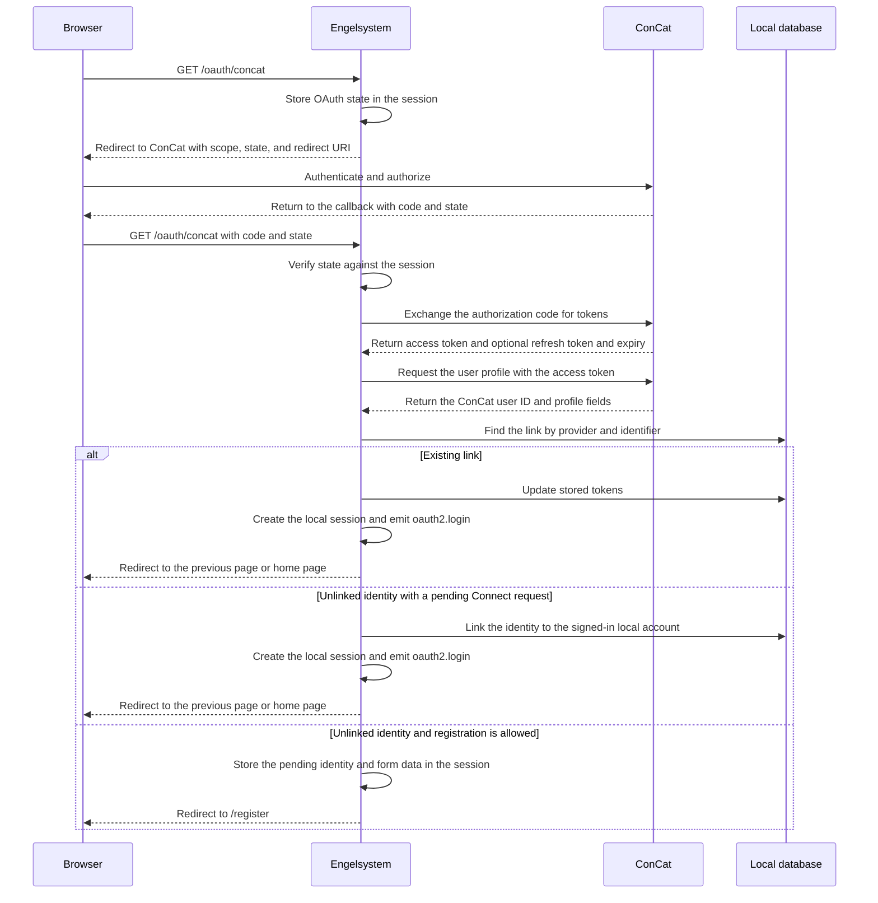

# ConCat sign-in for Engelsystem

ConCat is registered as the `concat` OAuth 2.0 provider. Engelsystem uses the shared OAuth
authorization code flow to verify the ConCat identity and start a local session. The local account
is linked by the pair `(provider, identifier)`, with `concat` as the provider and the ConCat user ID
as the identifier. Usernames, names, and email addresses serve as profile or registration data.
[OAuth controller](src/Controllers/OAuthController.php) · [OAuth model](src/Models/OAuth.php)

## Configure ConCat

The default provider is defined in `config/app.php`. It is registered when all five OAuth values
are nonempty strings. Without a complete environment configuration or a separate provider
configuration, the login button is absent and requests to `/oauth/concat` return
`oauth.provider-not-found`. The shared templates display **Login using ConCat** and add ConCat
to the Single Sign-On settings page once the provider is registered.
[Application configuration](config/app.php) · [Login template](resources/views/pages/login.twig)

| Environment variable | Purpose |
| --- | --- |
| `OAUTH_CLIENT_ID` | Client ID issued by ConCat |
| `OAUTH_CLIENT_SECRET` | Client secret used in the server-side token exchange |
| `OAUTH_URL_AUTHORIZE` | Endpoint the browser opens to authorize sign-in |
| `OAUTH_URL_ACCESS_TOKEN` | Endpoint Engelsystem uses to exchange the authorization code for tokens |
| `OAUTH_URL_RESOURCE` | Endpoint Engelsystem calls with the access token to retrieve the user profile |
| `APP_URL` | Public base URL for Engelsystem, including any path prefix |

To use a mounted secret, set `OAUTH_CLIENT_SECRET_FILE` to the file's path inside the web
container. Engelsystem reads the file when it exists and otherwise uses `OAUTH_CLIENT_SECRET`.
[Secret loader](src/helpers.php)

Register the exact callback URI in the ConCat client. Engelsystem appends `/oauth/concat` to
`APP_URL`. For example, `https://volunteers.example.org/team` produces
`https://volunteers.example.org/team/oauth/concat`. When the base URL is unset, the URL generator
uses the incoming request. Set the absolute public URL explicitly for deployments behind a
proxy. [URL generator](src/Http/UrlGenerator.php)

Engelsystem sends a space-separated scope value of `pii:basic con:read`, matching the old fork's
provider configuration. The legacy Terraform comment lists `user:read`. Verify the scopes allowed
by the actual ConCat client before rollout. The current integration uses the returned user ID for
sign-in and has no convention eligibility check based on `con:read`.

### Profile fields

| ConCat response field | Engelsystem use |
| --- | --- |
| `id` | Stored as `oauth.identifier` and matched with the provider key `concat` |
| `username` | Prefills the local registration username |
| `firstName` | Prefills the first name when that field is enabled |
| `lastName` | Prefills the last name when that field is enabled |

The default ConCat mapping leaves email entry to the user. Local registration requires a valid
email address and a username that are each unique. Confirm the provider's response format before
adding field mappings. [Registration factory](src/Factories/User.php)

### Configuration overrides

The application loads `config/app.php`, the deprecated `config/config.default.php`, and any local
`config/config.local.php` and `config/config.php` files in that order. Later files recursively
merge into the earlier configuration. Database event settings and supported environment options
are applied during startup. When ConCat is already registered, an `oauth.concat` override can
replace individual settings. When the environment leaves ConCat unregistered, a file-based
provider configuration must supply its own required fields. [Configuration loader](src/Config/ConfigServiceProvider.php)

The shared OAuth option `hidden` controls display in the login and settings templates. The page
title can reveal entries hidden this way, and a configured provider can still be reached at its
OAuth route. Incomplete environment configuration instead leaves the default provider
unregistered. [Settings template](resources/views/pages/settings/oauth.twig) · [Form scripts](resources/assets/js/forms.js)

## Run a local test deployment

Use a separate ConCat client and database for local or staging tests. The tracked Compose files
use the `deployment.env` file beside each Compose file. Create a private
`.local-tests/concat.compose.yml` override and set `services.es_server.env_file` in that override
to `${ENGELSYSTEM_DEPLOYMENT_ENV_FILE}`. Set the variable to an absolute path so the override
can be used with either base Compose file.
[Standard Compose file](docker/docker-compose.yml) · [Development Compose file](docker/dev/docker-compose.yml)

Create `.local-tests/concat.env` or use an environment file outside the repository. Replace the
example values with those issued for your test client. Register `http://localhost:5080/oauth/concat`
if the client permits local HTTP callbacks. For a client that requires HTTPS, use its staging
HTTPS URL for `APP_URL` and register the corresponding callback.

```dotenv
APP_URL=http://localhost:5080
OAUTH_CLIENT_ID=test-client-id
OAUTH_CLIENT_SECRET=test-client-secret
OAUTH_URL_AUTHORIZE=https://identity.example.org/oauth/authorize
OAUTH_URL_ACCESS_TOKEN=https://identity.example.org/api/oauth/token
OAUTH_URL_RESOURCE=https://identity.example.org/api/users/current
```

From the repository root, set the environment file path in PowerShell.

```powershell
$env:ENGELSYSTEM_DEPLOYMENT_ENV_FILE = Join-Path $PWD '.local-tests/concat.env'
```

In a POSIX shell, use the following command.

```sh
export ENGELSYSTEM_DEPLOYMENT_ENV_FILE="$PWD/.local-tests/concat.env"
```

Use a separate Compose project name for the test deployment. Run the migration command after
MariaDB is ready. The final command prints the PHP version from the running web container.

```sh
docker compose -p engelsystem-concat-test -f docker/docker-compose.yml -f .local-tests/concat.compose.yml config --quiet
docker compose -p engelsystem-concat-test -f docker/docker-compose.yml -f .local-tests/concat.compose.yml up -d --build
docker compose -p engelsystem-concat-test -f docker/docker-compose.yml -f .local-tests/concat.compose.yml exec es_server bin/migrate
docker compose -p engelsystem-concat-test -f docker/docker-compose.yml -f .local-tests/concat.compose.yml exec es_server php -v
```

Keep test credentials, environment overrides, and generated logs under `.local-tests/` or in an
external temporary directory. Git and the Docker build context exclude `.local-tests/`,
`.phpunit.cache/`, and local PHP configuration overrides.
[Git ignore rules](.gitignore) · [Docker ignore rules](.dockerignore)

## Deploy to Amazon ECS

The production Terraform configuration supplies these runtime values to the ECS task.

| Environment variable | Production value or source |
| --- | --- |
| `APP_URL` | `https://engelsystem.furcon.org` |
| `OAUTH_URL_AUTHORIZE` | `https://reg.furtherconfusion.org/oauth/authorize` |
| `OAUTH_URL_ACCESS_TOKEN` | `https://reg.furtherconfusion.org/api/oauth/token` |
| `OAUTH_URL_RESOURCE` | `https://reg.furtherconfusion.org/api/users/current` |
| `OAUTH_CLIENT_ID` and `OAUTH_CLIENT_SECRET` | ECS injects these from AWS Systems Manager Parameter Store |

Register `https://engelsystem.furcon.org/oauth/concat` with the production ConCat client. The
credentials are supplied at task startup. The production image build uses the same Dockerfile
as the standard Compose file. [Production Dockerfile](docker/Dockerfile)

### Use the existing Further Confusion database schema

Set `LEGACY_DATABASE_SCHEMA=true` in the Terraform task environment when this fork runs against
the existing Further Confusion database. The app reads the old attendance and goodie flags,
stores worklog descriptions in `worklogs.comment`, and checks the old volunteer-role permissions.
ConCat continues to use the existing OAuth links. The migration command refuses to run while
legacy schema mode is enabled. Leave the variable unset for databases on the current upstream
schema. [Configuration](config/app.php) · [Migration command](bin/migrate)

Legacy schema mode disables shift tags, plugins, log links, night-shift weighting, forced food,
and goodie reservations. The old database stores the force-active and goodie flags as booleans,
so their operator names are unavailable.

### Publish and roll out an image

1. Configure the deployment role's GitHub OIDC trust for this fork's `main` branch and the
   `sts.amazonaws.com` audience. Use the subject format emitted by this repository.
   [GitHub OIDC reference](https://docs.github.com/en/actions/reference/security/oidc#configuring-the-subject-in-your-cloud-provider)
2. Coordinate the handover from the old fork so one workflow publishes the production image tags.
   Pushing to `main` triggers the deployment workflow. [Deployment workflow](.github/workflows/deploy.yml)
3. The workflow builds the image and pushes it to the `engelsystem` ECR repository in `us-west-2`.
   It publishes the commit SHA, `1`, `1.0`, `1.0.<run_number>`, and `latest` tags.
4. The workflow deploys a revision based on the `engelsystem` task definition family to the
   `engelsystem` service in the `Fargate` cluster and waits for stability. By default, it uses
   the image reference from that definition. Terraform controls the desired task count.
5. To deploy the commit-SHA image explicitly, set `WRITE_NEW_TASK_DEFINITION_TAG` to `true`
   in the workflow. The default is `false`.

### PHP runtime

The production Dockerfile uses `php:8.5-fpm-alpine`, which tracks the latest published PHP 8.5
patch release in the official Alpine image. Use `docker build --pull -f docker/Dockerfile .`
from the repository root to refresh the base image during a local build. PHP 8.5.13 includes
fixes for PHP-FPM request smuggling (CVE-2026-129289) and session vulnerabilities that can lead
to remote code execution (CVE-2026-126714 and CVE-2026-115560). The current lock file pins
`league/oauth2-client` 2.9.0, whose PHP constraint excludes PHP 8.6. The PHP 8.6 trial also produced
warnings and deprecations in the current test suite. A running ECS task receives the patched PHP
runtime when it starts from the rebuilt application image.
[PHP 8.5.13 changelog](https://www.php.net/ChangeLog-8.php#8.5.13) · [Production Dockerfile](docker/Dockerfile) · [Dependency lock](composer.lock)

## How sign-in works

The shared `OAuthController` uses `GenericProvider` from `league/oauth2-client`. The browser
authenticates with ConCat and returns an authorization code. Engelsystem exchanges the code
server-side and reads the profile with the access token. Composer declares `^2.7` and currently
locks version 2.9.0.
[OAuth controller](src/Controllers/OAuthController.php) · [Composer requirements](composer.json)

| Method | Path | Purpose |
| --- | --- | --- |
| GET | `/oauth/concat` | Starts sign-in and receives the authorization callback |
| POST | `/oauth/concat/connect` | Starts linking ConCat to an existing local account |
| POST | `/oauth/concat/disconnect` | Removes the current account's ConCat links |
| GET | `/settings/oauth` | Shows the Single Sign-On settings page |
| GET or POST | `/register` | Displays or submits the local registration form |



The callback compares the supplied `state` with `oauth2_state` in the current session before
exchanging the code. A mismatch clears the stored state and returns `oauth.invalid-state`.
Following the database lookup, the controller compares identifiers case-sensitively in PHP.
A successful sign-in replaces the previous local session, sets `user_id` and the user's locale,
updates `last_login_at`, and emits `oauth2.login`. Subsequent requests resolve the local user
through the session. [Authentication controller](src/Controllers/AuthController.php) · [Authenticator](src/Helpers/Authenticator.php)

### First sign-in and registration

An unlinked ConCat identity goes to local registration when registration is allowed. The
controller stores the pending identity, tokens, and form values in the session.

| Session keys | Purpose |
| --- | --- |
| `form-data-username`, `form-data-email`, `form-data-firstname`, `form-data-lastname` | Prefill registration fields where a mapping exists |
| `oauth2_connect_provider`, `oauth2_user_id` | Identify the pending provider and external account |
| `oauth2_access_token`, `oauth2_refresh_token`, `oauth2_expires_at` | Hold the token data until the link is saved |
| `oauth2_enable_password`, `oauth2_allow_registration`, `oauth2_groups` | Supply provider-specific registration options and group data |

The registration form validates local required fields and uniqueness. The user factory writes the
user and the OAuth link in the same database transaction, then clears the pending provider, user
ID, and token values. Successful registration redirects to `/oauth/concat` to start a second
authorization flow. That callback signs in through the newly created link.
[Registration controller](src/Controllers/RegistrationController.php) · [User factory](src/Factories/User.php)

| Setting | Effect |
| --- | --- |
| `REGISTRATION_ENABLED` | Defaults to `true`. When disabled, an unlinked OAuth user needs a provider with `allow_registration` enabled. |
| Provider `allow_registration` | Allows entry to registration when the global setting is disabled. The `register` permission still applies. |
| `ENABLE_PASSWORD` | Defaults to `true` and controls password field visibility and ordinary registration. The password POST route still authenticates submitted credentials. |
| Provider `enable_password` | Defaults to `false` for OAuth registration and overrides the global setting for that flow. A new linked account starts with an empty local password under this default. |

### Link or unlink an existing account

1. Sign in to the existing local account and open **Settings** → **Single Sign-On** at
   `/settings/oauth`.
2. Select **Connect** for ConCat. The form submits a CSRF-protected POST and stores a pending
   link in the local session.
3. Authorize in ConCat. The callback links an unused ConCat identity to the signed-in local
   account when the pending provider matches. If another account owns the identity, the
   callback returns `oauth.already-connected`.

The settings page requires the `user_settings` permission. Use its form to start linking. A
direct visit to `/oauth/concat` starts the ordinary sign-in flow. Selecting **Disconnect** submits
a CSRF-protected POST and deletes all ConCat links for the current local user. The shared
`allow_user_disconnect` option defaults to `true` and can disable unlinking for a provider.
Disconnecting an account's sole sign-in method makes future sign-in unavailable through that
method.
[Settings controller](src/Controllers/SettingsController.php) · [Settings template](resources/views/pages/settings/oauth.twig) · [CSRF middleware](src/Middleware/VerifyCsrfToken.php)

## Identity storage and optional provider behavior

The existing `oauth` table stores identity links.

| Column | Purpose |
| --- | --- |
| `id` | Local link primary key |
| `user_id` | Foreign key to `users.id` with cascading deletion |
| `provider`, `identifier` | Provider key and external user ID, with a composite unique index |
| `access_token`, `refresh_token` | Nullable text containing the latest tokens |
| `expires_at` | Nullable token expiration timestamp |
| `created_at`, `updated_at` | Link creation and update timestamps |

The schema allows multiple external identities from one provider to link to the same local
account. On MySQL-compatible installations, the identifier migration applies `utf8mb4_bin`
collation and rebuilds the unique index. The application also uses a case-sensitive comparison
during lookup. [Table migration](db/migrations/2020_11_08_000000_create_oauth_table.php) · [Token columns](db/migrations/2020_12_25_000000_oauth_add_tokens.php) · [Token column types](db/migrations/2020_12_28_000001_oauth_change_tokens_to_text.php) · [Identifier collation](db/migrations/2025_12_12_000000_change_oauth_identifier_database_encoding_to_bin.php)

Tokens are stored directly as strings and updated on subsequent OAuth callbacks. Local sessions
have their own lifetime, independent of the stored ConCat token expiration. Engelsystem logout
invalidates the local session. Unlinking removes the local link and its stored tokens. Provider
sessions and token revocation are handled separately by ConCat.

The shared controller supports optional settings that ConCat omits by default.

| Option | Effect |
| --- | --- |
| `nested_info` | Allows field paths such as `user.id` through a flattened profile |
| `mark_arrived` | Records arrival at sign-in for a linked user awaiting check-in |
| `groups` and `teams` | Map external groups to local volunteer roles, known as angel types |
| `url` | Makes the provider name a link on the settings page |

If group mapping is configured, registration can preselect volunteer roles. The `oauth2.login`
listener adds associated roles and can grant and confirm supporter status. Its synchronization
applies to groups present in the profile. Existing memberships are retained when an external
group disappears. [OAuth login listener](src/Events/Listener/OAuth2.php)

## Troubleshooting

| Symptom | What to check |
| --- | --- |
| ConCat button missing or `oauth.provider-not-found` | Confirm that all five OAuth values reached `es_server` or the ECS task. Check configuration overrides and any explicit `hidden` setting. |
| Redirect URI rejected | Compare the exact callback registered in ConCat with `APP_URL` plus `/oauth/concat`, including the scheme, host, port, and path prefix. |
| `oauth.invalid-state` | Keep the same session and cookies from the initial request through the callback. Starting another authorization can replace the saved state. |
| `oauth.provider-error` | Check application logs for provider errors during the token exchange or profile request, and check for a conflicting identity record during linking. |
| `oauth.access_denied` or scope error | Check the user's consent and the permissions granted to the ConCat client. |
| `oauth.already-connected` | The ConCat identity is already linked to a different local account. |
| `oauth.not-found` or `registration.disabled` | Check the account link, global registration settings, provider settings, and the local `register` permission. |
| Registration asks for an email or rejects a duplicate | Supply a valid, unique local email. Users with an existing account should sign in to it and link ConCat in settings. |
| `Authentication Token Mismatch` | Start Connect or Disconnect from the settings form in the current session so the POST includes a valid CSRF token. |
| ECS workflow did not start | Check that the push updated `main`. |
| Image published and ECS still runs an older build | Check the service's task definition image tag and the deployment status. The ECR push and the ECS rollout are separate workflow steps. |

## Verification

Run the focused unit tests from the repository root with Composer development dependencies and
PDO SQLite installed.

```sh
composer phpunit -- \
  tests/Unit/Controllers/OAuthControllerTest.php \
  tests/Unit/Controllers/AuthControllerTest.php \
  tests/Unit/Controllers/SettingsControllerTest.php \
  tests/Unit/Controllers/RegistrationControllerTest.php \
  tests/Unit/Factories/UserTest.php \
  tests/Unit/Events/Listener/OAuth2Test.php \
  tests/Unit/Config/ConfigServiceProviderTest.php
```

The focused suite passed **121 tests** on PHP 8.5.13. The local checks also verified ConCat
configuration and authorization redirects with test values, environment injection in both
Compose files, and the GitHub Actions workflow with static and simulated deployment checks.
The production Dockerfile built successfully on the local Docker engine. The built container
reported PHP 8.5.13, and `php-fpm -t` passed.

The OAuth controller tests exercise the shared flow with mocked provider responses. The
registration feature tests cover form rendering and OAuth team preselection. A live sign-in
with a separate ConCat test client is needed to verify the endpoints, scopes, and callback
registration. The AWS rollout still requires deployment-environment verification.
[OAuth unit tests](tests/Unit/Controllers/OAuthControllerTest.php) · [Registration feature tests](tests/Feature/Controllers/RegistrationControllerTest.php) · [Test configuration](phpunit.xml)

## Code reference

| Area | Source |
| --- | --- |
| Routes and provider configuration | [Routes](config/routes.php) · [Application configuration](config/app.php) · [Configuration loader](src/Config/ConfigServiceProvider.php) |
| Authorization, account links, and sessions | [OAuth controller](src/Controllers/OAuthController.php) · [Authentication controller](src/Controllers/AuthController.php) · [Authenticator](src/Helpers/Authenticator.php) |
| Registration fields and validation | [Registration controller](src/Controllers/RegistrationController.php) · [Registration template](resources/views/pages/registration.twig) · [Form macros](resources/views/macros/form.twig) · [User factory](src/Factories/User.php) |
| Settings and permissions | [Settings controller](src/Controllers/SettingsController.php) · [Settings template](resources/views/pages/settings/oauth.twig) · [Settings layout](resources/views/pages/settings/settings.twig) · [Request handler](src/Middleware/RequestHandler.php) |
| Models and login events | [OAuth model](src/Models/OAuth.php) · [User model](src/Models/User/User.php) · [User model relation](src/Models/User/UsesUserModel.php) · [OAuth login listener](src/Events/Listener/OAuth2.php) |
| Admin and metrics | [User view](includes/view/User_view.php) · [OAuth metrics](src/Controllers/Metrics/Stats.php) · [Metrics controller](src/Controllers/Metrics/Controller.php) |
| UI strings | [English translations](resources/lang/en_US/default.po) · [Additional English strings](resources/lang/en_US/additional.po) · [German translations](resources/lang/de_DE/default.po) · [Additional German strings](resources/lang/de_DE/additional.po) |
